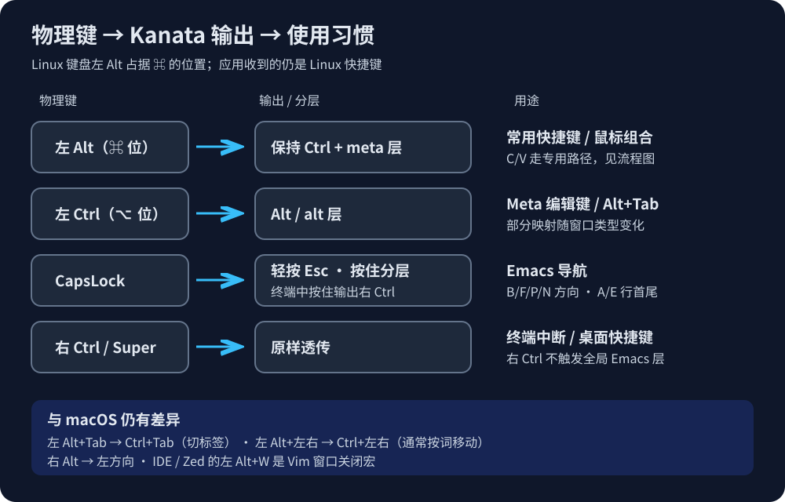
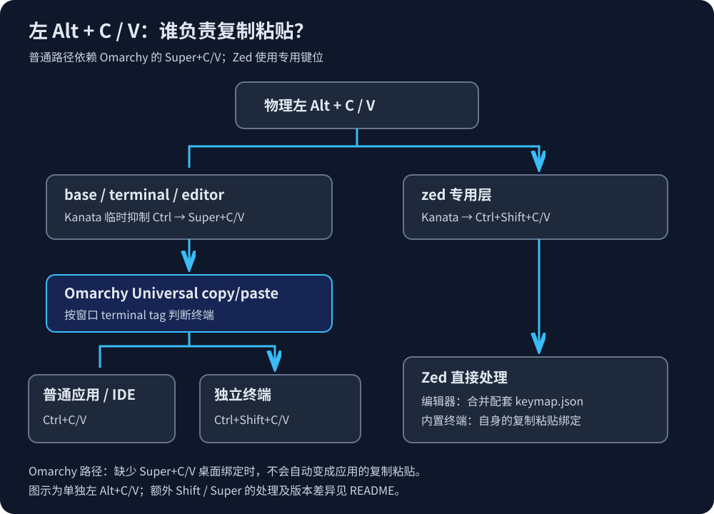

# omarchy-kanata-macos-keys-binding

**English** | [中文](readme-cn.md)

macOS-style shortcut positions on Omarchy / Hyprland, powered by Kanata, automatic per-window layers, and Emacs editing keys.

This repository captures a personal configuration that uses the physical left Alt key as the Command-position key. It does not reproduce every macOS shortcut and is intended for Linux, not macOS. Validated with Kanata 1.12.0, Python 3, and an Omarchy / Hyprland setup using Lua configuration.

## Key mapping



“Left Alt,” “left Ctrl,” and “CapsLock” below refer to physical keys. Output refers to the keys received by applications. The SVG diagrams currently have Chinese labels; the tables below explain the same mappings in English.

| Physical action | Output / behavior |
| --- | --- |
| Hold left Alt | Hold left Ctrl and activate the meta layer; this is the Command-position key |
| Left Alt + T/F/S/Z, etc. | Ctrl + the corresponding key; applications typically interpret these as new tab, find, save, undo, etc. |
| Left Alt + click / scroll | Ctrl + click / scroll; browser links usually open in background tabs, and scrolling usually zooms |
| Left Alt + C/V | Usually Super+C/V, handled by Omarchy; Zed has a dedicated path described below |
| Left Ctrl | Alt; also activates alt / alt-editor layers in regular applications and editors |
| Tap CapsLock | Esc, using a 200ms tap-hold-press threshold |
| Hold CapsLock | Activate Emacs layers in regular applications / editors; output right Ctrl in standalone terminals |
| Physical right Ctrl | Pass through unchanged; right Ctrl+C can still interrupt terminal programs |
| Physical Super / Shift | Pass through for desktop shortcuts and key combinations |
| Esc | Backtick (`) |
| Right Alt | Left arrow |

In regular applications and editors, CapsLock+B/F/P/N produces Left / Right / Up / Down, and CapsLock+A/E produces Home / End. Regular applications additionally support CapsLock+W/Y for cut / paste, D/H for deletion, K for cutting to the end of the line, S for search, and more. **These remappings are triggered by CapsLock, not the physical right Ctrl key.**

In regular applications / editors, left Ctrl+B/F moves by word, left Ctrl+V sends Page Up, and left Ctrl+comma / period moves to the beginning / end of the document. Regular applications also support left Ctrl+W for copy, D for deleting the next word, and Backspace for deleting the previous word. See [gen.py](kanata/gen.py) for the complete mapping.

## Copy and paste depend on Omarchy's Super+C/V



**Left Alt+C/V in regular applications, IDEs, and standalone terminals still depends on Omarchy's Universal copy/paste bindings.** Kanata translates the physical keys; Omarchy selects the shortcut to send based on the window type.

| Context | Kanata output | Handler |
| --- | --- | --- |
| Regular application / browser / IDE | Super+C/V | Omarchy sends Ctrl+C/V |
| Standalone kitty / alacritty terminal | Super+C/V | The current Omarchy implementation sends Ctrl+Shift+C/V |
| Zed editor | Ctrl+Shift+C/V | The supplied Zed editor bindings; bypasses Omarchy Universal copy/paste |
| Zed integrated terminal | Ctrl+Shift+C/V | Zed's terminal bindings; bypasses Omarchy Universal copy/paste |

On the source machine, the implementation lives in `/usr/share/omarchy/default/hypr/bindings/clipboard.lua`:

```lua
o.bind("SUPER + C", "Universal copy", universal_clipboard_shortcut("CTRL", "C", "CTRL SHIFT", "C"))
o.bind("SUPER + V", "Universal paste", universal_clipboard_shortcut("CTRL", "V", "CTRL SHIFT", "V"))
```

Omarchy recognizes terminals by the window's `terminal` tag, while the Kanata layer switcher uses window classes. These checks are independent. Running Kanata alone, removing the desktop's Super+C/V bindings, or using a desktop without those bindings will not provide copy/paste through the regular path. IDE integrated terminals may still follow the regular-application branch.

Holding left Alt continuously holds Ctrl so mouse combinations work. For C/V, `unmod` temporarily suppresses left Ctrl to send Super+C/V, then restores Ctrl when C/V is released. Do not replace this with a permanent Ctrl release: copying once could otherwise break subsequent clicks while left Alt remains held.

In the regular meta / meta-editor layers, additionally holding physical Shift preserves Ctrl+Shift+C/V. Left Alt+physical Super+V preserves Super+Ctrl+V for the desktop's clipboard-history binding. Zed uses its dedicated output instead of this C/V selection logic. The clipboard-history panel comes from the desktop configuration; this repository does not install it.

## Files and automatic layer switching

| File | Purpose |
| --- | --- |
| [kanata/gen.py](kanata/gen.py) | Configuration source; edit this and regenerate |
| [kanata/macos-emacs.kbd](kanata/macos-emacs.kbd) | Generated Kanata configuration |
| [bin/kanata-window-layer](bin/kanata-window-layer) | Polls Hyprland and switches layers through Kanata's TCP interface |
| [systemd/](systemd/) | Two systemd user services |
| [zed/keymap.json](zed/keymap.json) | Companion editor copy/paste bindings to merge into an existing keymap |

The switcher checks every 0.3 seconds by default and resends the selected layer every 15 seconds to recover from Kanata restarts:

| Focused window / overlay | Base layer |
| --- | --- |
| kitty, alacritty | terminal |
| jetbrains-webstorm, jetbrains-studio, Code, Windsurf (case-insensitive) | editor |
| dev.zed.Zed, dev.zed.Zed-Preview (case-insensitive) | zed |
| Omarchy overlays listed in the script's PANELS set | base; takes precedence over window detection |
| Other windows | base |

Add other terminals or editors to the script's `TERMINALS` / `EDITORS` sets. Inspect the actual class with `hyprctl -j activewindow`. Environment variables: `KANATA_PORT` defaults to 10000, `POLL` defaults to 0.3, and `QUIET=1` disables logging. If you change the port, also change `-p` in the Kanata service.

## Installation

Requirements: Kanata, Python 3, Hyprland with `hyprctl`, a systemd user session, and Omarchy's Super+C/V bindings.

1. Clone the repository:

   ```sh
   git clone https://github.com/aizigao/omarchy-kanata-macos-keys-binding.git
   cd omarchy-kanata-macos-keys-binding
   ```

2. **First edit `linux-dev` inside `RCFG` in `kanata/gen.py`.** The two device paths in this repository belong to the source machine. Replace them with your keyboard devices:

   ```sh
   ls -l /dev/input/by-id/*-event-kbd
   ```

   Include only keyboards you want to remap, not mouse devices. Without an explicit device list, Kanata may grab the mouse and interfere with OpenLogi's evdev gestures.

3. Generate and validate the configuration:

   ```sh
   python3 kanata/gen.py > kanata/macos-emacs.kbd
   kanata --check --cfg kanata/macos-emacs.kbd
   ```

4. Back up existing files with the same names, then install:

   ```sh
   mkdir -p ~/.config/kanata ~/.local/bin ~/.config/systemd/user
   install -m 644 kanata/gen.py kanata/macos-emacs.kbd ~/.config/kanata/
   install -m 755 bin/kanata-window-layer ~/.local/bin/
   install -m 644 systemd/*.service ~/.config/systemd/user/
   ```

5. Merge the object from [zed/keymap.json](zed/keymap.json) into the top-level array in `~/.config/zed/keymap.json`, preserving existing bindings. Zed's integrated terminal handles Ctrl+Shift+C/V itself; the editor needs the explicit bindings supplied here.

6. Make sure the graphical-session user can read the selected `/dev/input/event*` devices and write to `/dev/uinput`, and that no other remapper is grabbing the same keyboard. Follow your Kanata package's permission setup instructions rather than making devices globally readable and writable. Enable the services from your graphical session:

   ```sh
   systemctl --user daemon-reload
   systemctl --user enable --now kanata.service kanata-window-layer.service
   ```

The services require `WAYLAND_DISPLAY` in the systemd user environment. Layer switching also needs the correct `HYPRLAND_INSTANCE_SIGNATURE`. If missing, run `systemctl --user import-environment WAYLAND_DISPLAY HYPRLAND_INSTANCE_SIGNATURE` from a Hyprland session terminal, then restart the services. The Kanata service assumes `/usr/bin/kanata`; update `ExecStart` if your binary is installed elsewhere.

## Verification and troubleshooting

```sh
systemctl --user status kanata.service kanata-window-layer.service
journalctl --user -u kanata.service -u kanata-window-layer.service -n 80 --no-pager
```

Check manually: left Alt+click on a browser link; copy and then click a link while continuously holding left Alt; copy/paste in standalone terminals and the Zed editor / integrated terminal; right Ctrl+C to interrupt; layer switching between applications and typing in Omarchy overlays.

Stop the services with `systemctl --user disable --now kanata-window-layer.service kanata.service`. Killing the processes alone will restart them because of `Restart=always`.

To change an installed configuration, edit `~/.config/kanata/gen.py`, regenerate `~/.config/kanata/macos-emacs.kbd`, validate it with `kanata --check`, then run `systemctl --user restart kanata.service`.

## Differences from macOS and known limitations

- Left Alt+Tab sends Ctrl+Tab, usually switching tabs. Application switching still uses Linux Alt+Tab: physical left Ctrl+Tab.
- Left Alt+Left/Right sends Ctrl+Left/Right, usually moving by word. Left Alt+Backspace usually deletes a word. These differ from macOS Command shortcuts for line navigation and deletion to the beginning of the line.
- In editor / zed layers, left Alt+W sends `Ctrl+W`, waits 80ms, then sends `C` to close a Vim window. It requires an editor Vim mode / plugin that recognizes the sequence. The Zed integrated terminal also receives this macro, where it may delete a word and type `c`.
- A window class cannot distinguish the Zed editor from its integrated terminal. Other IDEs have the same internal-focus limitation.
- In base, left Ctrl+Space toggles mark mode; B/F/P/N then sends Shift+arrow. Normal editing operations do not automatically clear it. The layer switcher also reselects the base layer, so mark mode is not a persistent selection across windows.
- Left Ctrl+comma / period does not select different actions based on physical Shift.
- Layer selection uses polling at approximately 0.3-second intervals; actual delay also depends on Hyprland command execution. Unknown windows use base.
- Older xremap / Ctrl_R comments describe migration history. Refer to the generator logic and the physical-key descriptions in this document for current behavior.

This repository provides configuration files. It does not include Omarchy's clipboard implementation, install OpenLogi, or modify desktop bindings.
