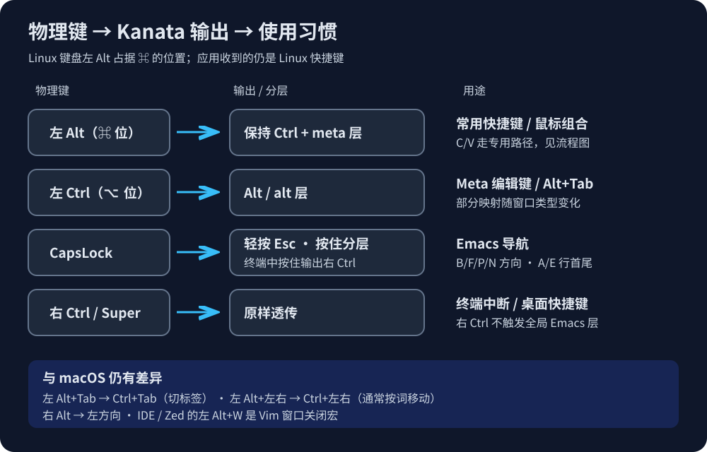
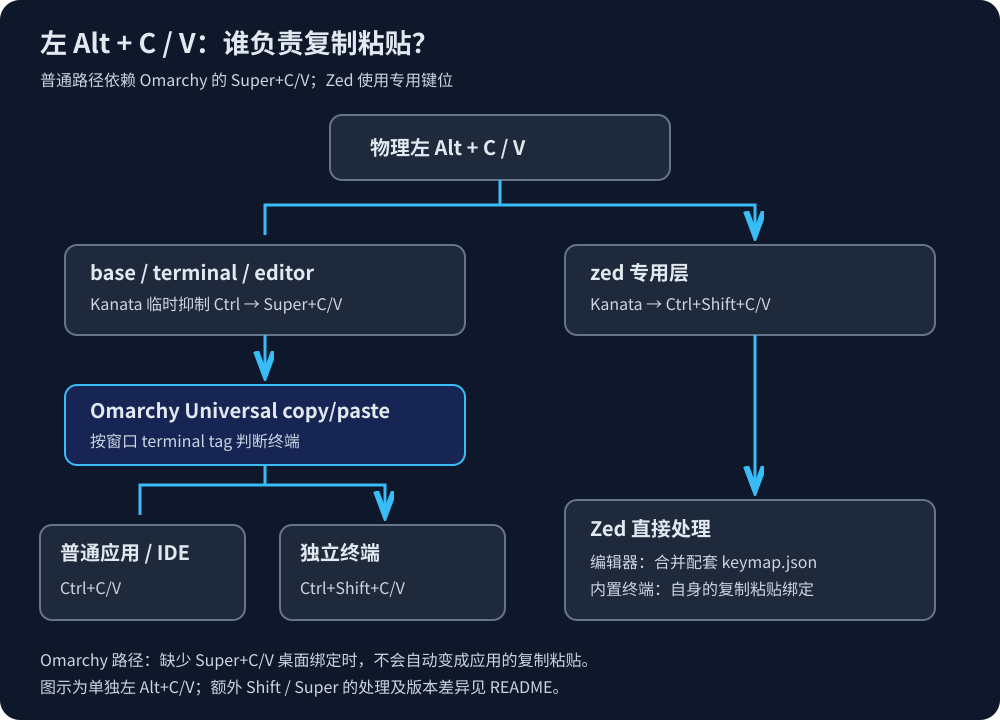

# omarchy-kanata-macos-keys-binding

[English](README.md) | **中文**

在 Omarchy / Hyprland 上使用 macOS 位置习惯的快捷键，结合 Kanata、按窗口自动切层和 Emacs 编辑键。

这是当前个人配置的可复现快照，使用 Linux 键盘的左 Alt 位置作为「⌘」。不是完整 macOS 键位仿真，也不是给 macOS 安装的配置。验证环境：Kanata 1.12.0、Python 3、使用 Lua 配置的 Omarchy / Hyprland。

## 键位关系



下文的「左 Alt」「左 Ctrl」「CapsLock」均指物理键；输出名称指应用收到的按键。

| 物理操作 | 输出 / 行为 |
| --- | --- |
| 左 Alt 按住 | 保持左 Ctrl，同时进入 meta 层；相当于 ⌘ 的位置 |
| 左 Alt + T/F/S/Z 等 | Ctrl + 对应键，由应用解释为新标签、搜索、保存、撤销等 |
| 左 Alt + 单击 / 滚轮 | Ctrl + 单击 / 滚轮；浏览器链接通常后台打开，滚轮通常缩放 |
| 左 Alt + C/V | 通常输出 Super+C/V，依赖 Omarchy；Zed 例外，见下节 |
| 左 Ctrl | Alt；普通应用和编辑器还进入 alt / alt-editor 层 |
| CapsLock 单击 | Esc，tap-hold-press 阈值 200ms |
| CapsLock 按住 | 普通应用 / 编辑器进入 Emacs 层；独立终端输出右 Ctrl |
| 物理右 Ctrl | 原样传递；终端右 Ctrl+C 仍可中断程序 |
| 物理 Super / Shift | 原样传递，供桌面快捷键及组合键使用 |
| Esc | Esc |
| 右 Alt | 左方向键 |

CapsLock+B/F/P/N 在普通应用和编辑器输出左 / 右 / 上 / 下；CapsLock+A/E 输出 Home / End。只有普通应用额外启用 CapsLock+W/Y 剪切 / 粘贴、D/H 删除、K 剪切到行尾、S 搜索等。**这些重映射由 CapsLock 触发，不是物理右 Ctrl。**

普通应用 / 编辑器中，左 Ctrl+B/F 按词移动，左 Ctrl+V 向上翻页，左 Ctrl+逗号 / 句号到文首 / 文末。普通应用还有左 Ctrl+W 复制、D 向后删词、Backspace 向前删词。完整映射见 [gen.py](kanata/gen.py)。

## 复制粘贴依赖 Omarchy 的 Super+C/V



**是的，普通应用、IDE 和独立终端的左 Alt+C/V 仍依赖 Omarchy 的 Universal copy/paste。** Kanata 负责键位转换，Omarchy 根据窗口类型决定发送什么快捷键。

| 场景 | Kanata 输出 | 后续处理 |
| --- | --- | --- |
| 普通应用 / 浏览器 / IDE | Super+C/V | Omarchy 转为 Ctrl+C/V |
| kitty / alacritty 独立终端 | Super+C/V | 当前 Omarchy 转为 Ctrl+Shift+C/V |
| Zed 编辑器 | Ctrl+Shift+C/V | 本仓库的 Zed 编辑器绑定处理，不经过 Omarchy 通用复制粘贴 |
| Zed 内置终端 | Ctrl+Shift+C/V | Zed 终端自身处理，不经过 Omarchy 通用复制粘贴 |

当前机器的实现可在 `/usr/share/omarchy/default/hypr/bindings/clipboard.lua` 查看：

```lua
o.bind("SUPER + C", "Universal copy", universal_clipboard_shortcut("CTRL", "C", "CTRL SHIFT", "C"))
o.bind("SUPER + V", "Universal paste", universal_clipboard_shortcut("CTRL", "V", "CTRL SHIFT", "V"))
```

Omarchy 使用窗口的 `terminal` tag 判断终端；Kanata 切层脚本使用窗口 class，二者不是同一套判断。仅启用 Kanata、删除 Super+C/V 桌面绑定，或换到没有这些绑定的桌面后，普通路径的复制粘贴不会自动成立。IDE 内置终端也可能仍走普通应用分支。

左 Alt 按住期间持续输出 Ctrl，保证鼠标组合有效；C/V 使用 `unmod` 临时抑制左 Ctrl，输出 Super+C/V，松开 C/V 后恢复 Ctrl。不要改成永久释放 Ctrl，否则复制一次后，继续按住左 Alt 再单击可能失效。

普通 meta / meta-editor 层中，另按物理 Shift 时保留 Ctrl+Shift+C/V；左 Alt+物理 Super+V 保留 Super+Ctrl+V，可交给桌面的剪贴板历史绑定。Zed 使用专用输出，不使用这套 C/V 判断。剪贴板历史面板本身由桌面配置提供，本仓库不安装面板。

## 文件与自动切层

| 文件 | 用途 |
| --- | --- |
| [kanata/gen.py](kanata/gen.py) | 配置源；修改它再重新生成 |
| [kanata/macos-emacs.kbd](kanata/macos-emacs.kbd) | 生成的 Kanata 配置 |
| [bin/kanata-window-layer](bin/kanata-window-layer) | 轮询 Hyprland，通过 Kanata TCP 接口切层 |
| [systemd/](systemd/) | 两个用户服务 |
| [zed/keymap.json](zed/keymap.json) | 仅包含配套复制粘贴的编辑器绑定，需合并进现有文件 |

切层默认每 0.3 秒检测一次，每 15 秒重发一次以应对 Kanata 重启：

| 聚焦窗口 / 浮层 | 基础层 |
| --- | --- |
| kitty、alacritty | terminal |
| jetbrains-webstorm、jetbrains-studio、Code、Windsurf（忽略大小写） | editor |
| dev.zed.Zed、dev.zed.Zed-Preview（忽略大小写） | zed |
| 脚本 PANELS 中的 Omarchy 浮层 | base，优先于窗口判断 |
| 其他窗口 | base |

需要其他终端或编辑器时，修改脚本的 `TERMINALS` / `EDITORS`。查看实际 class：`hyprctl -j activewindow`。脚本环境变量：`KANATA_PORT` 默认 10000、`POLL` 默认 0.3、`QUIET=1` 关闭日志；修改端口时需同步修改 Kanata 服务的 `-p`。

## 安装

前提：已安装 Kanata、Python 3，使用带 `hyprctl` 的 Hyprland、systemd 用户会话，并保留 Omarchy 的 Super+C/V 绑定。

1. 克隆仓库：

   ```sh
   git clone https://github.com/aizigao/omarchy-kanata-macos-keys-binding.git
   cd omarchy-kanata-macos-keys-binding
   ```

2. **先修改 `kanata/gen.py` 中 `RCFG` 的 `linux-dev`。** 仓库中的两个设备路径来自原机器，必须替换为你实际使用的键盘节点：

   ```sh
   ls -l /dev/input/by-id/*-event-kbd
   ```

   只列出需要重映射的键盘，不要包含鼠标节点。不限定设备可能独占鼠标，影响 OpenLogi 的 evdev 手势。

3. 生成并检查配置：

   ```sh
   python3 kanata/gen.py > kanata/macos-emacs.kbd
   kanata --check --cfg kanata/macos-emacs.kbd
   ```

4. 备份已有同名文件，再安装：

   ```sh
   mkdir -p ~/.config/kanata ~/.local/bin ~/.config/systemd/user
   install -m 644 kanata/gen.py kanata/macos-emacs.kbd ~/.config/kanata/
   install -m 755 bin/kanata-window-layer ~/.local/bin/
   install -m 644 systemd/*.service ~/.config/systemd/user/
   ```

5. 将 [zed/keymap.json](zed/keymap.json) 中的对象合并到 `~/.config/zed/keymap.json` 的顶层数组中，保留已有绑定。Zed 内置终端使用自身的 Ctrl+Shift+C/V；编辑器需要这里的显式绑定。

6. 确保图形会话用户能够读取所选 `/dev/input/event*`、写入 `/dev/uinput`，并且没有其他重映射器抢占同一键盘。按安装的 Kanata 软件包说明配置权限；不要用全局可读写的设备权限代替。然后在图形会话启用：

   ```sh
   systemctl --user daemon-reload
   systemctl --user enable --now kanata.service kanata-window-layer.service
   ```

服务要求 systemd 用户环境中存在 `WAYLAND_DISPLAY`。切层还需正确的 `HYPRLAND_INSTANCE_SIGNATURE`；若缺失，可在 Hyprland 会话终端执行 `systemctl --user import-environment WAYLAND_DISPLAY HYPRLAND_INSTANCE_SIGNATURE` 后重启服务。服务默认 Kanata 路径为 `/usr/bin/kanata`，其他安装位置需修改 `ExecStart`。

## 验证和排查

```sh
systemctl --user status kanata.service kanata-window-layer.service
journalctl --user -u kanata.service -u kanata-window-layer.service -n 80 --no-pager
```

手动验证：浏览器左 Alt+单击链接；保持左 Alt 按住，先复制再单击链接；独立终端与 Zed 编辑器 / 内置终端复制粘贴；右 Ctrl+C 中断；跨应用切层及 Omarchy 浮层输入。

停止服务：`systemctl --user disable --now kanata-window-layer.service kanata.service`。只杀进程会被 `Restart=always` 自动拉起。

修改安装后的配置：编辑 `~/.config/kanata/gen.py`，重新生成 `~/.config/kanata/macos-emacs.kbd`，通过 `kanata --check` 后执行 `systemctl --user restart kanata.service`。

## 与 macOS 的差异及已知限制

- 左 Alt+Tab 输出 Ctrl+Tab，通常切标签；切应用仍使用 Linux 的 Alt+Tab（物理左 Ctrl+Tab）。
- 左 Alt+左右输出 Ctrl+左右，通常按词移动；左 Alt+Backspace 通常删词，不是 macOS 的 ⌘ 行首 / 行尾和删到行首。
- editor / zed 的左 Alt+W 发送 `Ctrl+W`、等待 80ms、再发送 `C`，用于 Vim 窗口关闭。需要编辑器的 Vim 模式 / 插件识别；Zed 内置终端也走此宏，可能删词后输入 `c`。
- Zed 不能通过窗口 class 区分编辑器和内置终端；其他 IDE 同样存在内部焦点限制。
- mark 模式在 base 的左 Ctrl+Space 开关，进入后 B/F/P/N 为 Shift+方向；不会在普通编辑操作后自动清除。切层脚本还会重新选择基础层，不能把 mark 当成跨窗口持久选区。
- 左 Ctrl+逗号 / 句号未按物理 Shift 区分不同动作。
- 切层是轮询，存在约 0.3 秒间隔；实际延迟还取决于 Hyprland 命令执行。未知窗口默认 base。
- 物理 Esc 现在保持为 Esc。配置中的旧 xremap / Ctrl_R 注释是迁移背景；以生成逻辑及本文按物理键描述的行为为准。

本仓库只整理配置，不包含 Omarchy 的剪贴板实现，也不安装 OpenLogi 或修改桌面绑定。
